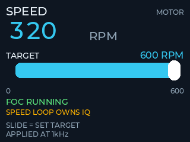
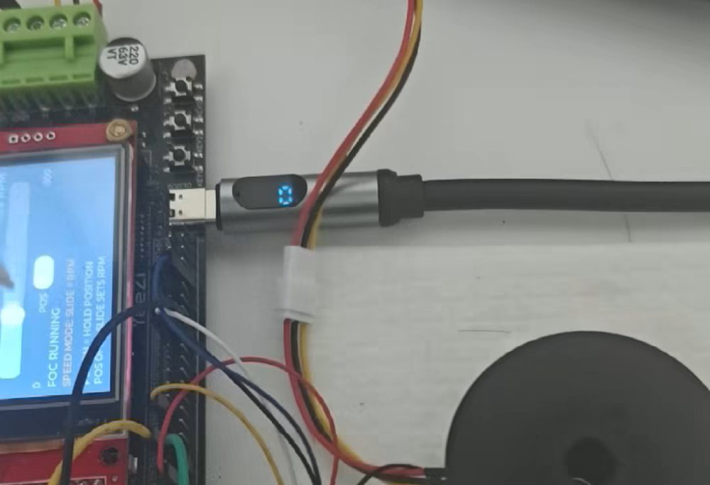
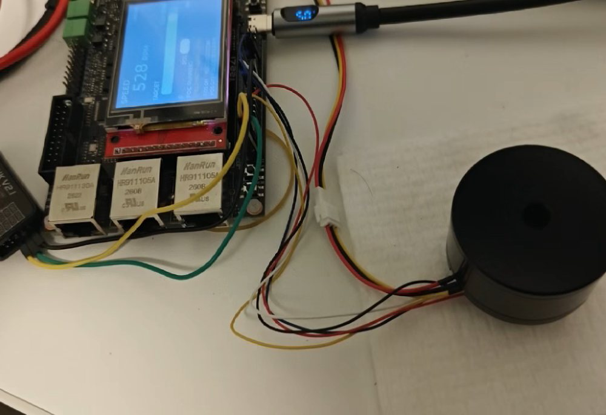
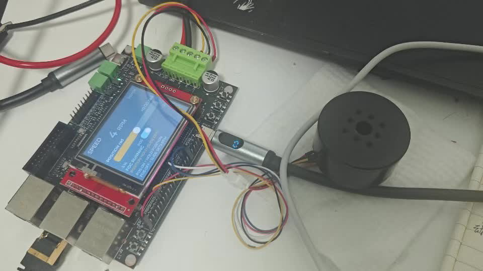

# YeeZi HPM6EMotor V2.0

> 基于国产**先楫半导体 HPM6E8Y**（双 RISC-V 核 @600 MHz）的**无刷电机 FOC 伺服固件**。
> core0 承担硬实时控制，core1 独立驱动一块 LVGL 触摸屏 —— 显示与控制在**物理隔离的
> 两个核**上，互不抢占。面向 4015 中空杯型电机的伺服驱动应用。



*界面布局（由 `tools/lcd_sim` 离线仿真渲染，非实拍）*

## 亮点

- **双核异构**：core0 = 20 kHz 电流环 + 1 kHz 速度/位置环；core1 = FreeRTOS + LVGL 9，
  两个核各跑一套独立的内核，显示卡顿影响不到控制节拍。
- **电流环跑在 ADC 完成中断内**：PWM/TRGM 硬件触发 + DMA + 抢占采样，采样点落在
  三相下桥同时导通的窗口中心；PLIC 优先级设为 7（高于 RTOS 临界区屏蔽线 4），
  所以任何 RTOS 临界区都遮挡不到它。
- **无锁共享内存协议**：16 KB 非缓存 RAM，单生产者-单消费者环 + 序号协议，
  遥测/命令/日志/心跳四条通道。
- **上电自检链**：ADC 存活探测 → 电流零点标定 → 四角度电流极性/相序辨识 →
  闭环方向验证，任何一步失败都会明确告诉你失败在哪、并保持输出封锁。
- **查表换向**：3200 组离线标定的"编码器原始角 → 电角度"，消除磁编码器的周期误差。
- **两个核的日志从同一根串口出**：core0 的日志经共享内存反向环交给 core1 转发，
  core0 那边一根线都不用接；调试输出有编译期总开关，出厂固件零打印。
- **片内 EtherCAT 从站（ESC）+ 2 路 100M PHY** 已完成引脚与时钟级可行性验证，
  为后续接入总线型伺服预留通道（见 [docs/design/ETHERCAT.md](docs/design/ETHERCAT.md)）。

## 核心指标

| 项目 | 指标 |
| --- | --- |
| 主控 | HPM6E8Y / HPM6E80，双 RISC-V 核，每核 600 MHz，BGA289 |
| 电机 | 4015 中空杯型无刷电机，11 极对；相电阻 2.7 Ω、相电感 1.3 mH |
| 功率级 | 三相全桥，20 kHz 中心对齐互补 PWM，死区 100 tick |
| 采样 | 10 mΩ 分流 + ×10 差分运放（1 LSB ≈ 0.504 mA），两电阻法，PWM/TRGM 触发 + DMA |
| 控制环 | 电流环 20 kHz（ADC 中断内）；速度环 1 kHz；位置环 1 kHz 外环 |
| 人机界面 | ILI9341 320×240（SPI1 + HDMA）、XPT2046 触摸、LVGL 9，5 ms/拍 |
| 通信 | 控制台 UART14 @921600（core1 独立串口）、USB CDC-ACM（CherryUSB）、双核共享内存 |
| 保护 | 过流 2 A（3 拍去抖锁死）、母线欠压、转速软限幅、ADC 帧存活看门狗 |
| 板卡 / SDK | `hpm6e00YZ` / `hpm_sdk_localized_for_hpm6e00YZ`（v1.12.1 本地化裁剪） |

软件分层 `main → app → FOC → BSP → Hardware`，中断留在 BSP 层经注册回调上抛，
外设与算法解耦。更详细的介绍见 [docs/design/PROJECT_INTRO.md](docs/design/PROJECT_INTRO.md)。

---

## 演示

| 实拍（点图看视频） | 说明 |
|---|---|
| [](docs/media/videos/lcd_ui_foc_running.mp4) | **界面 + FOC 闭环运行**（20 s）：屏幕实时刷新，`FOC RUNNING` / `SPEED MODE: SLIDE \| RPM` / `POS ON: HOLD POSITION`；core0 与 core1 各跑各的，互不抢占。 |
| [](docs/media/videos/motor_running_520rpm.mp4) | **整机运行 520 RPM**（4 s）：板载两颗 100M PHY（HR911105A，为 EtherCAT 预留）+ 4015 云台电机，屏幕大字实时显示转速。 |
| [](docs/media/videos/lcd_speed_mode_demo.mp4) | **界面速度页 + 位置模式**（实拍）：LCD 实时显示 `SPEED` / 转速 / 位置，4015 云台电机 + 板载双 100M PHY。 |

> GitHub 的 README 不支持内嵌播放 mp4，点图片进入 [`docs/media/videos/`](docs/media/videos/) 下载后本地播放。

速度环一阶 LADRC 的手写推导原稿在
[docs/design/SPEED_LOOP_LADRC.md](docs/design/SPEED_LOOP_LADRC.md)。

---

## 快速开始

### 构建

```bash
cmake -S . -B build -G Ninja -Dpython_exec=<你的 python.exe>
cmake --build build
```

产物：`build/output/demo.elf`（含 core0 与 core1 两个镜像）→ `build/output/demo.bin`

> **`-Dpython_exec` 必须显式给。** SDK 的代码生成脚本要 `yaml` 模块，
> 如果 CMake 抓到了 Microsoft Store 版的 `python3.exe`（没有 yaml），
> 配置会在 "Configuring done" 之前**静默卡住**、ninja 随后 0% CPU 空转，
> 看起来像编译卡死。实测可用：`D:/sdk_env/tools/python3/python.exe`。

### 烧写

```bash
D:/sdk_env/tools/openocd/openocd.exe -f openocd.cfg \
    -c "program build/output/demo.elf verify reset exit"
```

> **必须整包烧。** core1 的镜像嵌在 core0 的 elf 里（`.core1_img`，落在 flash
> `0x80100000`）。只烧一个核 / 两边版本不一致时，core1 会停在启动阶段 `0xE1`
> （黑屏），core0 的日志里能看到阶段码。
> 共享内存结构体（`src/dualcore/shm_core.h`）任何改动都会 bump `SHM_VERSION`，
> 这种情况下两个核**必须同一次烧写**。

---

## 双核分工

两个核各跑一套独立的 FreeRTOS（各自的堆、各自的 PLIC），优先级数值互不相干。

### core0 —— 电机控制核

| 任务 | 优先级 | 栈 | 周期 | 职责 |
|---|---|---|---|---|
| `log` | 15 | 4 KB | 事件驱动（队列入队即唤醒） | 日志：出队 + 延迟格式化 + 转发 core1 日志 + 心跳检查 |
| `Tmr Svc` | 15 | 1 KB | — | FreeRTOS 软件定时器任务 |
| `ctrl` | 14 | 4 KB | 1 ms | `app_run()`：位置环 / 速度环 / 编码器 / 按键 / 遥测 |
| `IDLE` | 0 | 1 KB | — | — |

中断：**电流环 ADC 20 kHz，PLIC 优先级 7**（> `configMAX_SYSCALL_INTERRUPT_PRIORITY`=4，
所以 RTOS 临界区**永远遮挡不到电流环**）；UART0 TX 优先级 3；USB 优先级 4。

> `log` 的优先级**高于** `ctrl` 是有意的：控制任务一旦超期，`vTaskDelayUntil`
> 就永不阻塞，比它低的任务一次都轮不到（实测 `log_tail` 冻结 2 秒、日志全丢）。
> 日志任务 99% 的时间阻塞在队列上，三个后端都是非阻塞的，只抢占几微秒。

### core1 —— 显示 / 控制台核

| 任务 | 优先级 | 栈 | 周期 | 职责 |
|---|---|---|---|---|
| `disp` | 6 | 8 KB | 5 ms | 取遥测快照 → LVGL（UI + 重绘 + 触摸）→ 串口轮询 + 转发 core0 日志 → 心跳 |
| `IDLE` | 0 | 1 KB | — | — |

`configUSE_TIMERS = 0`（core1 不需要软件定时器任务，省一份栈）。

### 核间通信

16 KB 非缓存共享 RAM（`0x012FC000`），无锁单生产者-单消费者环 + 序号协议：

```
core1 ──遥测 / 日志环(log)──▶ core0
core0 ──反向环(log0)───────▶ core1     ← core0 的日志经这里从 UART14 出去
core1 ──命令(cmd_*)────────▶ core0     滑条转速 / 位置环开关 / 位置目标
core0 ──遥测快照───────────▶ core1
core1 ──心跳───────────────▶ core0
```

**三个命令各用各的序号**（`cmd_seq` / `cmd_motion_seq` / `cmd_pos_seq`）。
共用一个序号会互相吃掉"有新命令"标志 —— 尤其"位置环使能"是**边沿事件**
（会让当前位置重新锁存成目标），和滑条共用序号就会导致每拖一次滑条位置环被重置一次。

---

## 控制参数（现场可调）

全在 [src/app/app.h](src/app/app.h)，改完重烧即可，**一次只改一个**再看现象。

| 宏 | 现值 | 作用 |
|---|---|---|
| `APP_MOTION_POS_KP` | 20.0 | 位置环 P，单位 RPM/rad（≈3.2 Hz 带宽） |
| `APP_MOTION_APPROACH_MIN_RPM` | 3.0 | **最小逼近速度**：接近目标时顶过静摩擦，治"越近越慢" |
| `APP_MOTION_DEADBAND_RAD` | 0.0015 | 到位死区（≈0.086°，约 4 个编码器 count） |
| `APP_MOTION_SPEED_LIMIT_RPM` | 60.0 | 位置环输出（速度给定）限幅 |
| `APP_SPEED_RAMP_RPM_S` | 1500 | 速度指令斜坡。**跟踪慢先查这里**，不是先调 PI |
| `APP_FOC_RPM_KNEE` | 0.8 | 软限速拐点：从 80% 的 `RPM_LIMIT` 起线性砍 iq |
| `APP_FOC_RPM_LIMIT` | 1000 | 软转速上限 |
| `APP_FOC_SPEED_KP` | 0.004 | 速度环 P（A / RPM 误差）—— **仅 PID 回退时使用** |
| `APP_FOC_SPEED_KI` | 0.06 | 速度环 I —— **仅 PID 回退时使用** |
| `APP_FOC_SPEED_IQ_LIMIT_A` | 1.5 | 速度环输出上限（过流门限约 2 A，只剩 0.5 A 余量） |
| `APP_SPEED_LOOP_ALG` | ADRC | 速度环算法：一阶 ADRC（默认）/ PID（回退、对比） |
| `APP_SPEED_ADRC_KV_RPM_PER_V` | 54 | 电机 KV（铭牌值），用于算 Kt = 9.5493/KV |
| `APP_SPEED_ADRC_J_KG_M2` | 3.0e-5 | 转动惯量（4015 中空云台典型值；未知时按此估） |
| `APP_SPEED_ADRC_B0_SCALE` | 1.0 | 实测 b0 / 推算 b0；默认信 KV/J 推算，实测不同只改这一个数 |
| `APP_SPEED_ADRC_WC_HZ` | 6.0 | ADRC 控制器带宽（与旧 PID 的 ≈6 Hz 对齐） |
| `APP_SPEED_ADRC_WO_RATIO` | 4.0 | 观测器带宽 = 4×wc（24 Hz） |

速度环默认是**一阶线性自抗扰（LADRC）**：对象 `dy/dt = b0·u + f`，
`b0 = Kt/J·(60/2π) ≈ 56290 RPM/(s·A)`，ESO 把负载、摩擦、反电动势和
`Kt/J` 误差一起估成 `z2` 并实时补偿，所以转动惯量未知也不影响稳定，
只影响起步力度。调参顺序：先 `WC_HZ`（跟踪快慢），再 `WO_RATIO`
（观测器跟不上就加、iq 高频发毛就减），`B0_SCALE` 最后按实测斜率校。

### 两条经验

1. **"跟踪慢"先怀疑斜坡和限幅，别先怀疑 PI。** 斜坡是加在**目标值**上的，
   环路每拍看到的是一条斜线而不是阶跃 —— 增益再大也只能跟着线走。
   例：`600 → 300 RPM` 在 500 RPM/s 下光爬斜坡就要 0.6 s。
2. **"最后一段爬、到不了位"是纯 P 位置环的通病**，不是增益不够：
   `spdref = kp·err` 在 err→0 时输出→0，而电机几 RPM 以下转不动（静摩擦 +
   速度环低速死区）。解法是"最小逼近速度 + 到位死区"这一对，见上面两个宏。

---

## 日志

两个核的日志**都从 core1 的 UART14 输出**（PF24 TXD / PF25 RXD），
core0 那边一根线都不用接：core0 的日志经共享内存反向环交给 core1 转发。
控制台参数：**921600 8N1**。

### 调试输出总开关

出厂固件**全部关闭**（不影响任何控制行为，只把 CPU 和串口还给控制环）。
见 [src/app/app.h](src/app/app.h) 的 "调试输出总开关" 一节：

```bash
-DAPP_DEBUG_ALL=1              # 全部打开（调参时）
-DAPP_LOG_IQ_RIPPLE=1          # 只开电流环 1s 峰峰值
```

| 宏 | 内容 |
|---|---|
| `APP_TELEMETRY_ENABLE` | 周期 CSV（电流 6 列 / 电角度+编码器），**100 Hz，最贵的一项** |
| `APP_LOG_FOC_LINE` | FOC 状态行（14 参数） |
| `APP_LOG_IQ_RIPPLE` | 电流环 1s 峰峰值（判据：几十 mA 正常，几百 mA = 自激） |
| `APP_LOG_ENC_HEALTH` | 编码器体检行（185 字符） |
| `APP_LOG_CTRL_PERIOD` | 控制任务周期统计（`avg`/`max`/`bad`） |
| `APP_LOG_ISR_STAT` | ADC 中断统计（实测次数 / 最大间隔） |
| `APP_LOG_BTN_LEVEL` | 按键电平 |

**故障告警不受这些开关影响**（过流、ADC 中断被拖长、编码器丢帧、
标定失败等事件型日志），它们稳态下不产生输出，且与安全相关。

---

## 屏幕操作

```
┌──────────────────────────────┐
│  RPM 大字（4 位定宽数字）      │
│  ┌────────────────────────┐  │
│  │ 滑条（随模式切换）        │  │
│  └────────────────────────┘  │
│  [POS 开关]                  │
│  反馈行 / 回读                │
└──────────────────────────────┘
```

- **POS ON（位置模式）**：滑条变成**位置目标**，范围 **−3.14 … +3.14 rad**，
  初始在正中间。拖到哪，位置环守到哪。
- **POS OFF（速度模式）**：滑条是**目标转速**（0 … 600 RPM）。
- 两个滑条共用同一块区域（320×240 排不下两条），按模式二选一显示。

---

## 目录结构

```
src/
  app/        应用层: app.c(主循环/速度环) app_motion.c(位置环) app_log.c(日志)
              app_diag.c(诊断) app_scope.c(电流环录波) app_nv.c(参数存储)
  FOC/        foc.c / pid.c / LADRC.c / foc_math.c — 与硬件无关的算法
              (LADRC.c: 一阶自抗扰, 速度环默认使用)
  bsp/        板级驱动: pwm / adc / usb / mt6701 / button / spi_bb
  lcd/        LVGL 界面、LCD 硬件层、等宽数字点阵字体
  dualcore/   共享内存协议(shm_core.h) + core1 启动/同步
  rtos/       core0 的任务划分与 FreeRTOS 配置
core1/
  src/        core1 专属: 控制台(UART14) / 共享内存客户端 / 显示入口
  rtos/       core1 的任务划分与 FreeRTOS 配置
  linker/     core1 独立的链接脚本
tools/        构建辅助 Python 脚本（字体生成、语法检查、共享内存日志解码）
hpm_sdk_localized_for_hpm6e00YZ/   本地化裁剪的 HPMicro SDK（随仓库一起提交）
docs/
  README.md   文档索引
  design/     架构/算法文档（PROJECT_INTRO / DUAL_CORE / SPEED_LOOP_LADRC / ETHERCAT）
  hardware/   原理图 PDF、J11 引脚表、编码器协议
  reports/    LCD 通路排查记录
  media/      images/ 截图与照片、videos/ 实拍演示
```

---

## 文档

全部资料都在 [`docs/`](docs/README.md)（[文档索引](docs/README.md)）。常用入口：

| 文件 | 内容 |
|---|---|
| [docs/design/PROJECT_INTRO.md](docs/design/PROJECT_INTRO.md) | 工程简介与核心指标（**先读这个**） |
| [docs/design/DUAL_CORE.md](docs/design/DUAL_CORE.md) | 双核架构、共享内存协议、启动流程 |
| [docs/design/SPEED_LOOP_LADRC.md](docs/design/SPEED_LOOP_LADRC.md) | 速度环一阶 LADRC：手稿推导 ↔ `LADRC.c` 逐行对照 |
| [docs/design/ETHERCAT.md](docs/design/ETHERCAT.md) | 片内 EtherCAT 从站（ESC）的可行性验证与引脚/时钟 |
| [docs/hardware/J11_pinout.md](docs/hardware/J11_pinout.md) | J11 扩展排针引脚定义 |
| [docs/hardware/HPM6EMotorV20.pdf](docs/hardware/HPM6EMotorV20.pdf) | 板卡原理图（V2.0） |
| [docs/hardware/encoder_SRMA35/](docs/hardware/encoder_SRMA35/README.md) | 锐鹰 SRMA35/46 RS485 多圈绝对值编码器协议 |
| [docs/reports/LCD_DISPLAY_FIX_REPORT.md](docs/reports/LCD_DISPLAY_FIX_REPORT.md) | 显示问题排查记录（SPI/DMA/时序） |
| [docs/reports/LCD_RPM_TEARING_FIX.md](docs/reports/LCD_RPM_TEARING_FIX.md) | 转速大字撕裂/乱码的定位过程 |
| [docs/reports/LCD_SPI_DMA_NOTES.md](docs/reports/LCD_SPI_DMA_NOTES.md) | LCD SPI + HDMA 的实现笔记 |

---

## 已知的坑

- **本工程目前是软浮点**：`-march=rv32imac… -mabi=ilp32`，而芯片 `misa` 里
  F/D 是有的。20 kHz 电流环里约 300~500 次浮点运算全都编译成 `__mulsf3` 之类的
  函数调用，实测吃掉 core0 **约 85~90% 的 CPU**（证据：关掉电流环后控制周期从
  2.1 ms 掉到 0.28 ms）。开硬件 FPU 收益很大，但 HPM 这版 FreeRTOS 端口的
  FPU 上下文与栈帧布局需要重新核对（`portContext.h` 里宏是有的），属高风险改动。
- **共享内存是非缓存的，可缓存变量不能用调试器直接读**：OpenOCD 通过 SBA 读的
  是内存，不是 CPU 的 D-Cache。ISR 每秒写两万次的变量在调试器里会显示成上电初值。
  只有 `0x012FC000` 起的 SHARE_RAM 和里面的日志环可以直接 dump。
- **`APP_MAIN_LOOP_MS` 的 1 ms 是硬指标**：控制任务一旦周期性超期，
  `vTaskDelayUntil` 就不再阻塞，所有低优先级任务（日志）全部饿死。判断依据看
  `ctrl period: bad(>2ms)` 这个计数。
