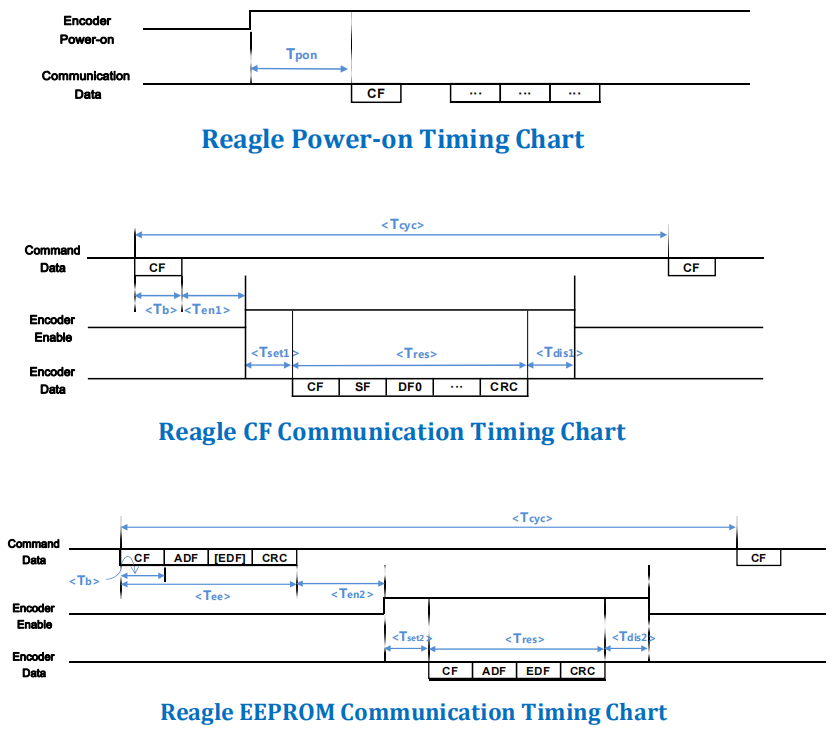

# 锐鹰 SRMA35/46 分体式多圈绝对值编码器 —— 通信协议摘录

来源：厂商规格书 `103317e5b469473.pdf`（锐鹰传感 / Reagles，V2.2，2024-03-29）第 7、8 章。
本目录只保留**通信相关**内容，供写驱动时对照；机械/安装章节见原厂 PDF。

- 型号：`SRMA35-M16S17BIT-SYH-C-5V` / `SRMA46-M16S17BIT-SYH-C-5V`
- 单圈 17 bit（131072） + 多圈 16 bit（65536），RS485 差分，**2.5 Mbps**
- 供电 5 V（4.75–5.25 V，典型 72 mA）；BAT 3.6 V 维持多圈，静态 7 µA，<3.1 V 报警

## 本目录文件

| 文件 | 说明 |
|---|---|
| [protocol_text.txt](protocol_text.txt) | 原 PDF 全 19 页的文本层提取（含非通信章节，供检索） |
| [protocol_layout_xy.txt](protocol_layout_xy.txt) | 第 11–16 页带 `(x,y)` 坐标的文本，用来还原被排版打散的帧图 |
| [timing_chart.png](timing_chart.png) | 原 PDF 第 15 页时序图（上电 / CF 通信 / EEPROM 通信） |

## 1. 物理层

| 项 | 值 |
|---|---|
| 电气 | RS485 差分，半双工 |
| 速率 | 2.5 Mbps |
| 字格式 | 1 起始位 + 8 数据位 + 1 停止位，**低位在前** → 10 bit/字节 = **4 µs/字节** |
| 命令周期 | `Tcyc ≥ 62.5 µs`（即通信频率 ≤16 kHz） |
| 上电可用 | `Tpon` 350–500 ms 之后才接受命令 |

线序（端子 1–8）：`5V / GND / 485+ / 485- / BAT+ / BAT- / NC / NC`；
线色：红 5V、黑 GND、蓝 485+、黄 485−、棕 BAT+、白 BAT−。

## 2. 帧格式（关键：编码器会回显 CF）

主机发 **CF（+ 可选 ADF/EDF/CRC）**，编码器返回 **CF 回显 + SF + DF0…DFn + CRC**。

> 手册正文用 `（CF+SF+ABS+CRC）` 描述"整次交互"，容易误读成请求帧要带 CRC。
> 实际请求只有 CF 一个字节 —— 依据是 7.3.1 的帧图（请求行只有 1 个格子）、
> 7.3.2 的"请求帧与返回帧内容相同"、以及第 15 页时序图里
> `Encoder Data: CF SF DF0 … CRC`。

**CRC = 除 CRC 字节外所有字节的异或**（多项式 x⁸+1）。

| 功能 | CF | 主机发 | 编码器回 |
|---|---|---|---|
| 单圈位置 | `0x02` | 1 B | 6 B：`02 SF ABS0 ABS1 ABS2 CRC` |
| 多圈位置 | `0x8A` | 1 B | 6 B：`8A SF ABM0 ABM1 ABM2 CRC` |
| 编码器 ID | `0x92` | 1 B | 4 B：`92 SF ENID CRC`（ENID 默认 `0x11`） |
| 全部信息 | `0x1A` | 1 B | 11 B：`1A SF ABS0-2 ENID ABM0-2 ALMC CRC` |
| 写 EEPROM | `0x32` | 4 B：`32 ADF EDF CRC` | 4 B，原样回显 |
| 读 EEPROM | `0xEA` | 3 B：`EA ADF CRC` | 4 B：`EA ADF EDF CRC` |
| 故障复位 | `0xBA` | 1 B ×10 | 6 B（含当前单圈值） |
| 单圈清零 | `0xC2` | 1 B ×10 | 6 B，掉电保持 |
| 多圈清零 | `0x62` | 1 B ×10 | 6 B，同时清所有故障 |

三条复位指令要求**间隔 ≥62.5 µs 连发 10 次**才生效。

## 3. 数据解码

```c
single_turn = ABS0 | (ABS1 << 8) | (ABS2 << 16);   /* ABS2 高 7 位恒 0 → 17 bit */
multi_turn  = ABM0 | (ABM1 << 8);                  /* ABM2 恒 0      → 16 bit */
```

- `SF`：Bit4 = Counting Error，Bit5 = `ALMC.Bit5|Bit6|Bit7` 的逻辑或，其余保留为 0
- `ALMC`：Bit0 超速（5 V 模式 >7200 RPM）、Bit2 单圈解算故障、Bit5 多圈丢失、
  Bit6 电池错误、Bit7 电池报警（<3.1 V）

## 4. 时序



| 符号 | 含义 | 值 |
|---|---|---|
| `Tb` | 字节时间 | 4 µs |
| `Tcyc` | 命令周期（最小值） | 62.5 µs |
| `Tpon` | 上电到可通信 | 350–500 ms |
| `Ten1` / `Tset1` / `Tdis1` | CF 模式的使能 / 建立 / 释放 | 1.5–3.5 / 0.8–2 / 1.2–2 µs |
| `Tres` | 返回帧时长 | `4·N` µs（N 为返回字节数） |
| `Tee` | EEPROM 命令时长 | 12 µs（读 3 B）/ 16 µs（写 4 B） |
| `Ten2` / `Tset2` / `Tdis2` | EEPROM 模式对应值 | 7.5 / 1.8 / 2 µs |

读写 EEPROM 发完 **20 µs 内**编码器回发，其间不要再发命令。

## 5. EEPROM

地址 `0x00–0x7E` 为可读写用户参数区，共 8 页；`0x7F` 是页选择寄存器（只能写 0–7）；
擦写寿命 10 万次。**页切换后地址如何重映射、第 8 页保留区范围，手册没写清**，
用之前建议先读回校验。

## 6. 接进本工程要注意

- 本工程现在的编码器是 MT6701（SSI，14 bit 单圈、无多圈），见 `src/bsp/bsp_mt6701.c`。
  换这颗编码器后 `mt6701_angle_to_rad()` 的 14 bit 掩码要改成 17 bit，
  `app_encoder_t.raw_angle` 要扩成 32 bit（单圈 + 多圈）。
- 2.5 Mbps 建议 **UART + DMA 定长收**：帧内字节间隔只有 0–2 µs，逐字节中断会被淹没。
- 收发器要选 ≥2.5 Mbps 的型号（MAX3485 / THVD1450 一类），总线两端 120 Ω 终端；
  `485+/-` 与 A/B 的对应关系手册未说明，首次接线用示波器确认极性。
- 轮询建议直接发 `0x1A` 一次拿全 11 字节（位置 + 多圈 + ID + 故障），
  比分别发 `0x02` / `0x8A` 省一半时间。
